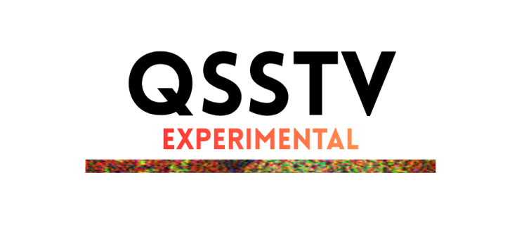

# QSSTV-Experimental

  

QSSTV-Experimental is an amateur-radio program for sending and receiving **SSTV** (slow-scan television) and **HAMDRM / DSSTV**
(digital SSTV) pictures using a sound card. It is compatible with most of MMSSTV and EasyPal.  Substantial changes have been made versus upstream QSSTV.

It is a fork of **QSSTV 9.5.11**, written by **Johan Maes, ON4QZ** (copyright 2000-2019, <https://www.qsl.net/o/on4qz>).
The HAMDRM software in QSSTV is based on RX/TXAMADRM by **PA0MBO**. Further contributions to the Qt6/macOS/FreeBSD
porting and fixes came from Jörg Wunsch (DL8DTL), Daniele Forsi, hspil, Ruxton, AsciiWolf, Barry de Graaff, Greg Tangey and
Sam Saccone. This program is based in part on QSSTV and, like it, is released under the GNU GPL v3 (see `COPYING` and `LICENSE`).

## Original QSSTV Features

- Receive and transmit SSTV in the common mode families: Martin, Scottie, Robot, PD, Wraase SC2, Pasokon, AVT, BW, FAX480, and the MP/MR/ML/MC families
- HAMDRM (DSSTV) receive and transmit
- Image gallery for received and transmitted pictures
- Image viewer for gallery pictures
- TX templates with macros, text and image items; stock and template libraries
- Image import and export in PNG, JPEG, GIF, BMP and JPEG 2000
- Rig control through Hamlib, CAT, serial (RTS/DTR) and VOX PTT, and XML-RPC remote control
- CW identification, FSK ID, and a waterfall / spectrum / scope display

## Changes versus upstream QSSTV 9.5.11

### Platforms

- **Windows** (64-bit, 10 1809 or later, or 11)
- **Linux AppImage** (x86_64/arm64 - Ubuntu 24.04, Fedora 40 or similar and later; needs glibc 2.39 or newer)
- **macOS** (macOS 15 or later, Intel or Apple Silicon; tested by several users and working. Bug reports are welcome)

### What's New?
#### Features

- **Experimental KG-STV** — native image/ASCII text RX/TX and manual BSR repair, with MSK/4L-FSK tabs and audio-file decoding. See [KG-STV implementation and validation](docs/KGSTV.md); original outbound/BSR and physical-device interoperability remain unverified.

- **Sample-rate calibration** - from WWV time ticks, NTP, or the slant of a received SSTV picture
- **Decode SSTV from audio files** - (WAV, MP3, FLAC, OGG, AAC), from the GUI (*File > Decode SSTV From File...*) at about 10x real time, or from the command line with `qsstv-experimental --batch`, headless, with scriptable exit codes. `qsstv-experimental --listen` is the live counterpart: a headless receiver that saves the pictures from a sound card input (`--device`, `--list-devices`)
- **New SSTV modes:** - *JB60*, a ~61 s 640*496 color mode, and *PD120W*, a 16:9 widescreen PD120
- **Stitched grid images:** - transmit pictures as 1x2, 2x1 or 2x2 grids on the higher resolution SSTV modes and DRM
- **Pan/Zoom images for transmission** - Place images exactly how you want them in-frame (and in grids) before transmission
- **Gallery multi-select** - to delete or send several images to TX, with the Del key for quick deletion
- **WebP, AVIF and HEIC** - image formats, with EXIF/HEIF orientation applied on import
- **Image viewer zoom and pan:** - smooth mouse-wheel zoom and drag-to-pan
- **Clipboard support:** - copy images from anywhere, paste into the transmit window or TX stock
- **New template editor** - rebuilt from scratch for the overlay on transmitted pictures: undo/redo, zoom, snapping, gradients, shadows, text boxes that wrap and shrink to fit, group resize and rotate, layers, a macro palette, starter templates and color bars, and a size preview of the template on every SSTV mode. Templates keep their proportions on modes of another shape (items are anchored to the edges) instead of being stretched. Templates are saved in a new, safe `.qtempl` format; old `.templ` files still open. Pictures are edited in your own picture editor (a copy, the original is never touched)
- **ADIF logbook broadcast over UDP** - on every OS
- **DRM Live size-slider preview:** - the picture preview updates as the slider is dragged
- **DRM Progressive Image Reception** - Image previews as you receive, improving in quality over time
- **Follows Desktop Themes** - On Linux builds (also should on other OSs.  I'm not buying a Windows license to find out)

#### Other changes and updates

1. Fixed - Changing audio devices results in the receiver not starting back up correctly
2. Fixed - Images in the viewer show 0x0 dimensions
3. Fixed - Loading a new image into TX Stock disappears after relaunching the app
4. Fixed - When deleting an image from the gallery, image properties don't shift with the rest of the images
5. Fixed - Various size and fitment UI issues
6. Fixed - Audio level issues compared to MMSSTV, added stereo output
7. Fixed - Image editor now places elements in the center of the screen (used to disappear)
8. Fixed - Save Waterfall Image now works
9. Fixed - Preamble and Postamble TX tones, including FSK ID
10. Fixed - TX Test Pattern in both SSTV and DRM modes
11. Fixed - DRM failed to display an image even though one was received on later builds
12. Fixed - DRM transmitter and receiver mismatched "boosted pilot tables"
13. Fixed - Crash when aborting file dialog TX with "To sound card and record"
14. Fixed - Test signal dialog doesn't save user settings
15. Fixed - Crash when audio device fails to initialize on startup
16. Fixed - CW ID at the end of a DRM image
17. Fixed - Camera will not save over 1280x960 image from certain flakey devices
18. Fixed - Mode and sensitivity combos in SSTV mode needed receiver restart to take effect
19. Updated - From Qt5/qmake to Qt6/cmake
20. Updated - From platform-specific audio, camera, and serial port devices to Qt-based abstracted devices (cross-platform)
21. Updated - Splash and icons
22. Updated - Documentation.  Now both offline and online.
23. Removed - Dead or abandoned code or assets
24. New - Automatic update notifications

## Download a pre-built release

Ready-to-run builds are published on the [Releases page](https://github.com/jbdubbs/QSSTV-Experimental/releases):

- **Linux:** download the `.AppImage`, make it executable (`chmod +x QSSTV-Experimental-*.AppImage`) and run it.
- **Windows:** download and run the `-win64.exe` installer. The installer is unsigned, so Windows SmartScreen may warn: choose "More info", then "Run anyway".
- **macOS (experimental):** Released for Intel/Apple Silicon but no testing hardware.  Give it a try, and file an issue if it doesn't work. MacOS 15 or later.
## User's Guide

The guide is built into the app (**Help > Users Guide**) and also published online at <https://jbdubbs.github.io/QSSTV-Experimental/>.

## Building

See [BUILDING.md](BUILDING.md) for building from source on Linux, Windows and macOS, the AppImage build, and the image-format plugin requirements.

## AI-assisted development disclosure

The original QSSTV by Johan Maes, ON4QZ, contains no AI-generated material. QSSTV-Experimental, this fork, was developed
with extensive AI involvement: AI tools (Anthropic's Claude, via Claude Code) generated or assisted with the
fork's new and changed code, documentation, build/packaging scripts and metadata. Every change has been tested by humans, and
the result was quality-controlled by multiple individuals involved in the project; nothing is released on the basis of AI
output alone.

## License and attribution

QSSTV-Experimental is free software under the GNU GPL v3 (`COPYING`, `LICENSE`). It contains code from QSSTV (Johan Maes, ON4QZ),
RXAMADRM (PA0MBO), the Dream DRM software, Phil Karn's Reed-Solomon codec and others, and bundles Qt, Hamlib, FFTW and image libraries
in binary releases. See [THIRD_PARTY_LICENSES.md](THIRD_PARTY_LICENSES.md) for the full list with licenses; it is also shown in
*Help > About > Third-party licenses...* and installed with every release.

## Thank you!

I'd like to record a special thank you to all the testers of QSSTV-Experimental:

- Stephen WA8LMF (http://wa8lmf.net/) (Extensive Windows SSTV and DRM testing of nearly every test release)
- Rick KC8LOQ (Testing and feedback on several Windows releases)
- Finn KF8GTK (Testing and feedback on Linux releases)
